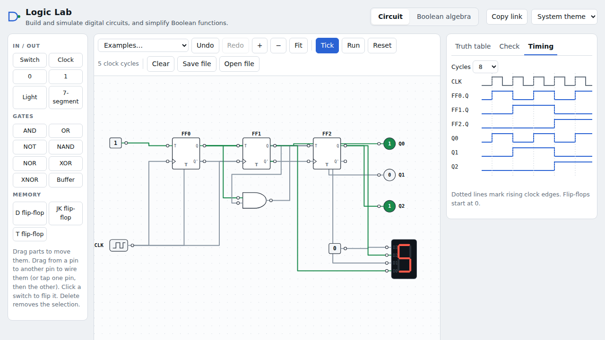
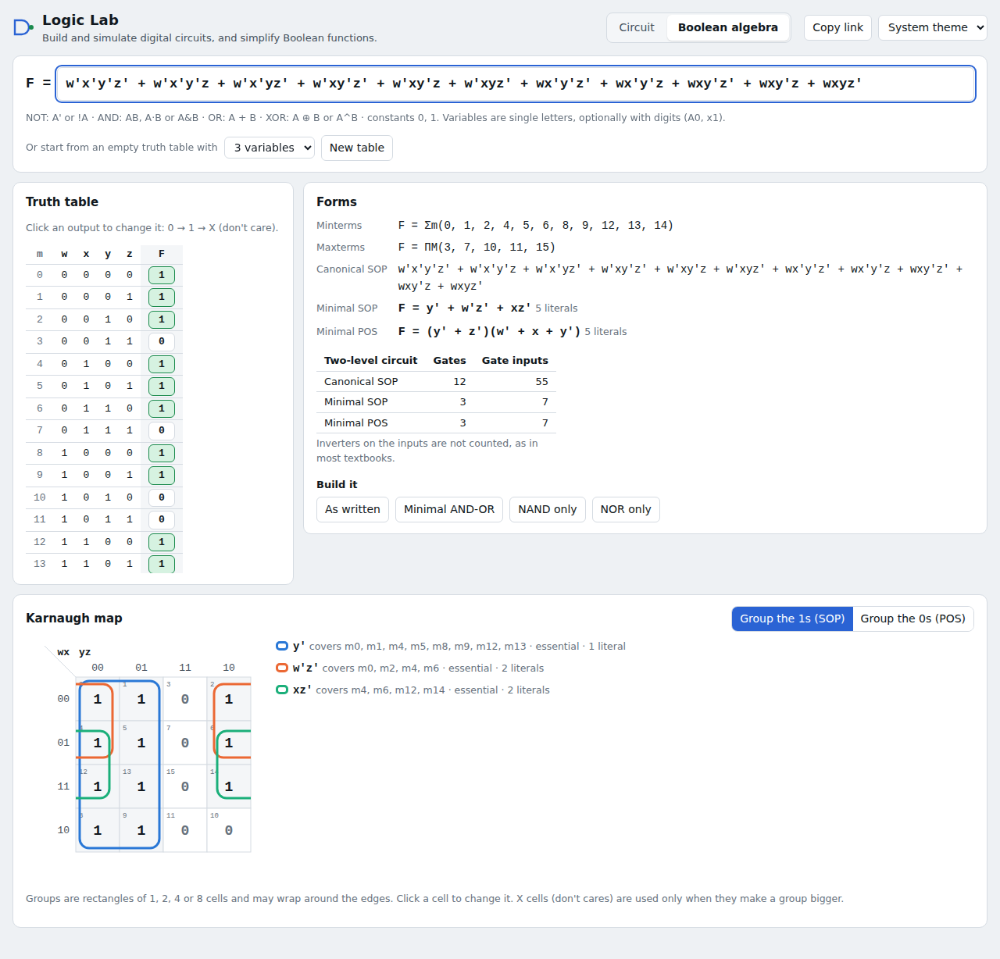

# Logic Lab

**Live:** <https://usamaattia.github.io/logic-lab/>

**A digital logic lab that runs in the browser, for an introductory digital design course.
Students build and simulate gate-level circuits, get their truth tables and expressions
automatically, check a circuit against a target function, and simplify Boolean functions
with Karnaugh maps.**



## Circuit editor

- **Parts:** switches, clock, constants, lights, a 7-segment display (hex), AND, OR, NOT, NAND,
  NOR, XOR and XNOR with 2 to 8 inputs, a buffer, and D, JK and T flip-flops. Gates use the
  standard distinctive shapes.
- **Editing:** place, drag (snapped to a grid), and wire by dragging from pin to pin, or by
  tapping one pin and then the other on a phone. Also undo and redo, pan and zoom, and
  keyboard delete.
- **Live simulation.** Every wire shows its level: green for 1, grey for 0, and dashed amber
  for **X (unknown)**. Click a switch to flip it. With a clock, use Tick, Run and Reset.
- **The truth table and expression of every output,** derived from the wiring, with the
  minimal sum of products next to it. The row for the switches' current setting is
  highlighted.
- **Check.** Type what an output *should* be (for example `A'B + AB'`) and the circuit is
  compared on every input combination. Where it differs, it names the row: "Different
  when A = 1, B = 1: the circuit gives 0, it should be 1". This works as automatic marking
  for lab exercises.
- **Timing diagrams** for sequential circuits: clock, flip-flop outputs and lights, with the
  rising edges marked.
- **Examples:** half and full adder, 2-to-1 multiplexer, 2-to-4 decoder, majority voter, NOR SR
  latch, gated D latch (NAND), 3-bit synchronous counter, and a ring oscillator.
- Work is saved in the browser. You can also save and open circuit files, and copy a link
  that contains the whole circuit.

## Boolean algebra



- Type an expression in the notation students use (`A'B + AB'`, `!A & B`, `NOT A AND B`,
  `A ⊕ B`, `(A + B)(A' + C)`), or start from an empty truth table and click outputs through
  0 → 1 → X (don't care).
- **Forms:** Σm and ΠM lists, canonical SOP, and the **minimal SOP and POS** with literal
  counts, plus a cost table (gates and gate inputs) comparing canonical and minimal two-level
  circuits.
- **Karnaugh map** for 2 to 4 variables in Gray-code order. Each chosen group is outlined in
  its own colour, including groups that wrap around the edges and the four corners. You can
  group either the 1s (SOP) or the 0s (POS). Essential prime implicants are marked, and you
  can click a cell to change it. For 5 and 6 variables the prime implicant table is shown
  instead.
- **Build it:** turn the function into a circuit in the editor, built **as written**, as a
  **minimal AND-OR**, as **NAND only** or as **NOR only**. The NAND and NOR versions use tied
  inputs for inverters, as in the textbook.

## How the simulator works

It uses **three-valued logic (0, 1, X).** An unconnected input, or a latch that has never
been set, is X, not a guessed 0. This shows students that an SR latch has no defined state
until it is set.

**Every gate has a unit delay, and the simulator updates all gates at once until nothing
changes.** Feedback therefore works: the latches in the examples are built from gates, not
special parts. Circuits that can't settle are detected and reported by name:

- the ring oscillator (a NAND feeding itself, enabled by a switch);
- an SR latch whose S and R fall from 1 together.

It never hangs.

**Flip-flops are edge-triggered parts** that act on the rising clock edge and start at 0.
Ripple counters work because a flip-flop can be clocked by another flip-flop's output.

**Minimisation is exact.** Quine–McCluskey finds the prime implicants. A branch-and-bound
search then picks the cover with the fewest terms, then the fewest literals. That is the
answer Petrick's method gives, including for "cyclic" functions with no essential prime
implicants.

## Tested against the textbook

Mano & Ciletti, *Digital Design*, worked examples:

| function | expected | ✓ |
|---|---|---|
| F(x,y,z) = Σm(0,2,4,5,6) | z' + xy' | ✓ |
| F(w,x,y,z) = Σm(0,1,2,4,5,6,8,9,12,13,14) | y' + w'z' + xz' (5 literals) | ✓ |
| F = Σm(1,3,7,11,15) + d(0,2,5) | yz + w'x' (don't cares used) | ✓ |
| F = Σm(0,1,2,5,8,9,10) | SOP x'y' + x'z' + w'y'z; POS with 3 sums, 6 literals | ✓ |
| Σm(0,2,8,10) | x'z': the four corners of the K-map, drawn as a wrapped group | ✓ |

Beyond the worked examples, **property tests** ([fast-check](https://fast-check.dev)) check
rules that must hold for every input, on thousands of random cases:

- the minimal SOP and POS always implement the function;
- no chosen term can be dropped from the cover;
- the result never costs more than the canonical form;
- expressions survive printing and parsing;
- the "as written", NAND-only and NOR-only circuits all compute the same function when simulated.

The simulator has its own tests:

- the full adder adds;
- simulated truth tables agree with the derived expressions for every example;
- the SR latch sets, holds and resets, and races when S and R fall together;
- the ring oscillator is reported rather than hanging;
- an unconnected input names itself in the analysis;
- D, JK and T flip-flops change only on the rising edge;
- the counter counts 0 to 7 and wraps, on the 7-segment display too.

End-to-end browser tests (Playwright, desktop and phone) cover:

- building an XOR circuit from scratch by dragging parts and wires and by tap-to-connect;
- flipping a switch;
- checking the circuit against a correct and a wrong target;
- undo;
- the latch, the oscillator, the counter and its timing diagram;
- minimising and building a NAND-only circuit;
- editing a truth table with don't cares;
- error messages;
- reload persistence;
- a touch session that deletes a wire and reconnects it by tapping pins;
- dark mode;
- no sideways scrolling at 360 px.

```
npm test          # 36 unit and property tests
npm run test:e2e  # 12 browser tests on desktop and phone sizes
```

## Running and publishing

```bash
npm install
npm run dev            # http://localhost:5173
npm run build          # static site in dist/
npm run build:single   # dist-single/index.html: one file that works offline
```

`.github/workflows/pages.yml` tests, builds and publishes to **GitHub Pages** on every push to
`main`. Set it up once under Settings → Pages → Source: GitHub Actions. The single-file
build is published next to it as `logic-lab-offline.html`, for labs without internet or
for uploading to an LMS.

## Layout

```
src/logic/            no UI code; everything here is unit-tested
  expr.ts             parser (textbook and keyboard notations), printer, evaluator
  truth.ts            truth tables, Σm / ΠM, canonical SOP and POS
  qm.ts               Quine–McCluskey, exact minimum cover, SOP and POS, two-level cost
  kmap.ts             Gray-code layout and wrap-around group rectangles
  circuit.ts          model, three-valued simulator, flip-flops, analysis, timing traces
  build.ts            expression → circuit (as written, NAND-NAND, NOR-NOR), auto-layout
  library.ts          example circuits
src/ui/               React: editor (SVG), circuit panels, Boolean algebra page
tests/  e2e/          unit/property tests; Playwright tests
```

React 19, TypeScript and Vite, with hand-written SVG for the editor, K-maps and timing
diagrams. There is no diagram or chart library, and the whole app is 87 KB gzipped.

## Ideas for later

Subcircuits (build a full adder once, reuse it four times), buses and multi-bit displays,
asynchronous set/reset on flip-flops, and state-machine design from a state table.

## Licence

MIT.
